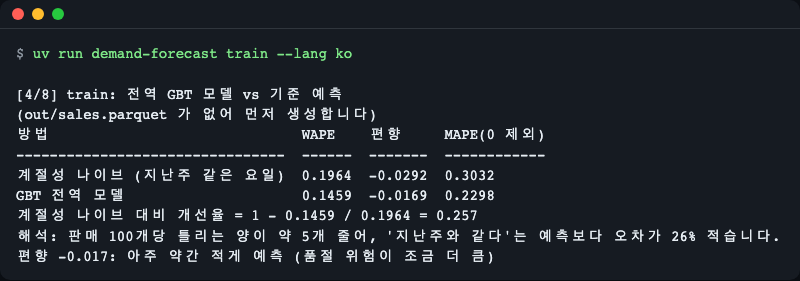
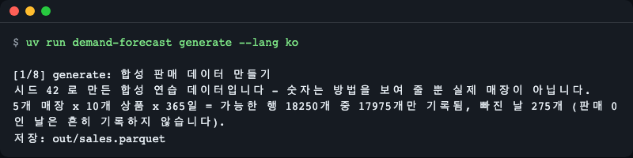
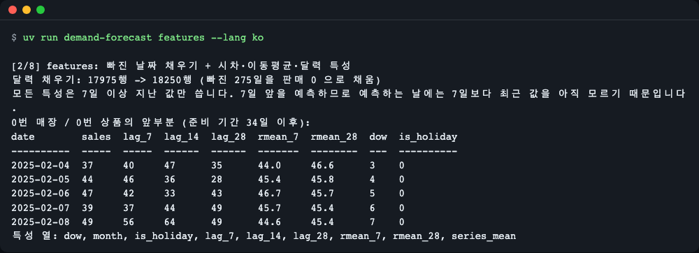
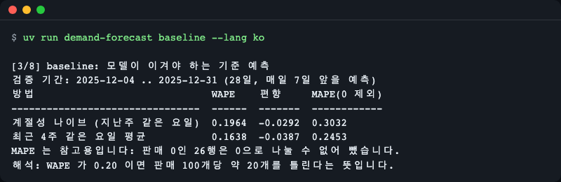
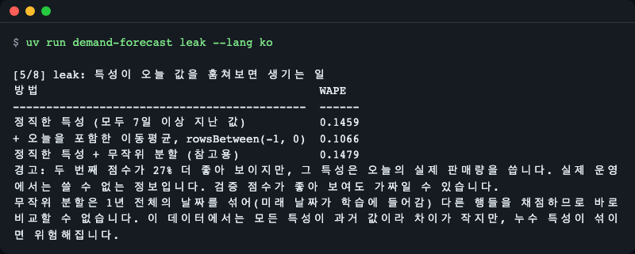
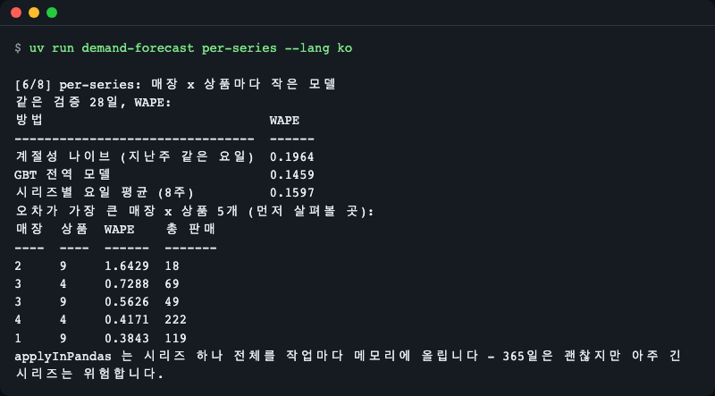
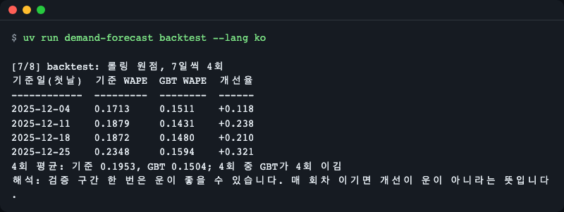
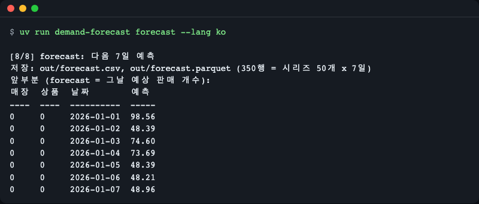
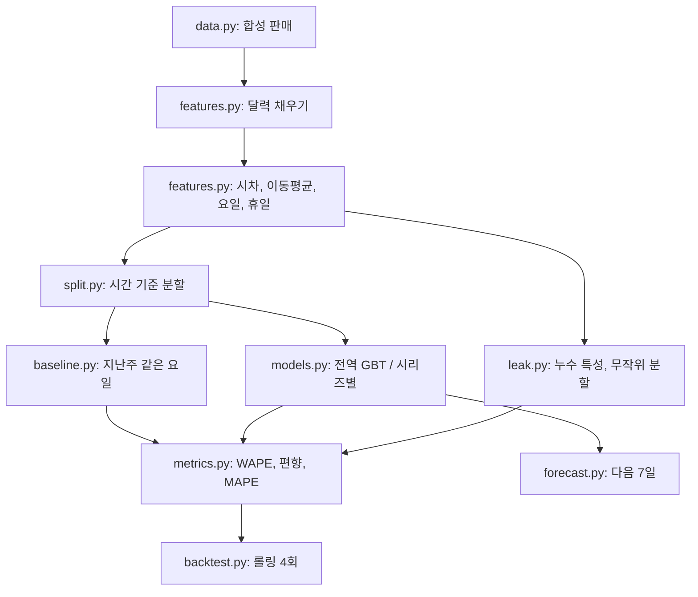

# PySpark로 수요 예측 배우기: 시차 특성, 누수, WAPE를 한 단계씩

[English](README.md) | **한국어**

여러 매장·상품의 다음 7일 판매량을 PySpark로 예측해 보는 작은 명령줄 데모입니다. 미래를 훔쳐보지 않도록 시차(lag)·이동평균·요일·휴일 특성을 만들고, 모델이 "지난주와 같다"는 단순 예측보다 정말 나은지 WAPE로 확인합니다. `uv run demand-forecast all` 한 줄로 실행하며, Java 17 이상이 필요하지만 API 키도, 실행 중 인터넷도 필요 없습니다. PySpark 숫자 데이터 시리즈 5편 중 3편입니다.


<sub>`train` 단계: 검증 28일에서 모델의 WAPE(0.1459)와 기준 예측의 WAPE(0.1964)를 나란히 보여 줍니다.</sub>

> **연습용 데이터 안내.** 판매 데이터는 시드 42로 만든 **합성 데이터**입니다. 숫자는 방법을 보여 줄 뿐 실제 매장이 아닙니다. 이 문서의 숫자는 한 컴퓨터에서 한 번 돌린 예시입니다. 같은 시드면 거의 같게 나오지만, 플랫폼이나 Spark 버전에 따라 조금 다를 수 있습니다.

## 한 줄 요약

이 데모를 따라 하면 PySpark 윈도 함수로 누수 없는 시계열 특성을 만들고, 다음 7일 수요를 예측하고, 모델이 가장 단순한 예측보다 정말 나은지 WAPE로 판단할 수 있습니다.

**이런 분께:** 판매·수요 예측을 처음 해 보는 분, PySpark 집계는 알지만 시계열 특성은 처음인 분, `mlforecast` 같은 도구를 쓰기 전에 안에서 무슨 일이 일어나는지 보고 싶은 분.

## 왜 알아야 하나요?

동네 빵집 사장님이 지난주 판매량을 보고 내일 반죽 양을 정한다고 해 봅시다. "지난 화요일과 같게"는 꽤 괜찮은 규칙입니다. 예측 모델은 이 규칙보다 반죽을 덜 버리게 해 줄 때만 쓸 가치가 있습니다. 모델이 실제보다 좋아 보이게 만드는 함정이 둘 있습니다. 하나는 주문하는 시점에는 없을 정보를 모델에게 보여 주는 것(누수), 다른 하나는 운 좋은 며칠에서 딱 한 번만 재 보는 것입니다. 이 데모는 두 함정을 실제 숫자로 보여 주고, 공정한 비교까지 해 봅니다.

## 시리즈

| 편 | 레포 | 주제 |
|---|---|---|
| 1 | [ai-lab-pyspark-sales-aggregation](https://github.com/LeeGyeongPil/ai-lab-pyspark-sales-aggregation) | 판매 집계 |
| 2 | [ai-lab-pyspark-price-regression](https://github.com/LeeGyeongPil/ai-lab-pyspark-price-regression) | 가격 회귀 |
| 3 | **ai-lab-pyspark-demand-forecast** (이 레포) | 수요 예측 |
| 4 | ai-lab-pyspark-churn-scoring | 이탈 점수 (예정) |
| 5 | ai-lab-pyspark-anomaly-detection | 이상 탐지 (예정) |

각 편은 따로 봐도 됩니다.

## 30초 만에 실행하기

Java 17 이상, [uv](https://docs.astral.sh/uv/), git이 필요합니다.

```bash
# macOS:  brew install uv openjdk@21
# Linux:  curl -LsSf https://astral.sh/uv/install.sh | sh   and   sudo apt-get install -y openjdk-17-jre-headless git
git clone https://github.com/LeeGyeongPil/ai-lab-pyspark-demand-forecast.git
cd ai-lab-pyspark-demand-forecast
uv run demand-forecast all
```

처음 실행할 때는 Python 3.12와 PySpark를 내려받습니다(네트워크에 따라 몇 분). 그 뒤로는 전체가 약 1분 걸립니다(제 실행은 53초). 결과는 `out/` 폴더에 저장됩니다.

출력 언어는 `LANG` 을 따릅니다. 시스템이 한국어면 첫 실행도 한국어로 나옵니다. 영어로 보려면 `--lang en` 을 붙이세요([언어 바꾸기](#언어-바꾸기) 참고).

목(mock) 모드는 없습니다. Spark가 여러분 컴퓨터에서 진짜로 계산합니다. "연습용"인 것은 데이터를 만들어 쓴다는 점뿐입니다.

Java는 자동으로 찾습니다(`JAVA_HOME`, Homebrew `openjdk@21`/`@17`, `/usr/lib/jvm/*`, `PATH` 순서). Java 17 이상이 없으면 Java 오류 대신 설치 방법을 안내하고 종료 코드 2로 끝납니다.

Spark는 프로젝트 안의 임시 폴더(`.spark-tmp/`)를 씁니다. 그래서 JVM이 stderr에 `Picked up JAVA_TOOL_OPTIONS: ...` 줄을 찍는데 해롭지 않습니다. `2>/dev/null` 로 숨길 수 있습니다.

## 단계별로 따라 하기

각 단계가 따로 실행되는 명령이어서 출력을 하나씩 읽을 수 있습니다. 앞 단계 파일이 필요한 단계는 먼저 만들어 줍니다. 모든 단계에서 `--stores`, `--items`, `--days`, `--seed`, `--out`, `--tmp-dir`(또는 `DEMAND_FORECAST_TMP` 변수), `--lang en|ko` 옵션을 쓸 수 있습니다.

기존 `out/sales.parquet` 가 다른 `--stores/--items/--days/--seed` 로 만들어졌다면, 그렇다고 알려 주고 데이터를 다시 만들며 옛 `report.json` 과 forecast 파일을 지웁니다. 쓰인 옵션은 `out/sales.params.json` 에 기록됩니다.

### 언어 바꾸기

출력은 영어 또는 한국어입니다. 우선순위는 `--lang en|ko`, 환경변수 `DEMAND_FORECAST_LANG`, `LC_ALL` / `LC_MESSAGES` / `LANG` 순이고, 한국어가 아니면 영어로 나옵니다.

```bash
uv run demand-forecast all --lang ko
DEMAND_FORECAST_LANG=ko uv run demand-forecast baseline
```

### 1단계. `generate`: 연습용 데이터 만들기

```bash
uv run demand-forecast generate
```


<sub>5개 매장 x 10개 상품 x 365일, 그중 275일은 기록이 없습니다.</sub>

보이는 것: 가능한 18,250행 중 17,975행만 기록되어 있습니다. 데이터에는 주말 판매 증가, 고정 휴일의 상승, 완만한 증가 추세, 잡음, 판매 0인 날이 많은 느리게 팔리는 상품, 그리고 **빠진 행**(판매 0인 날의 70%는 기록하지 않음, 실제 시스템에서 흔한 일)이 들어 있습니다. 숨기는 것은 없습니다. 생성 코드는 [`data.py`](src/demand_forecast/data.py)입니다.

### 2단계. `features`: 달력을 채우고 시차·평균 붙이기

```bash
uv run demand-forecast features
```


<sub>0번 매장 / 0번 상품의 앞부분: `sales` 는 정답이고, 나머지 열이 모델이 쓸 수 있는 정보입니다.</sub>

보이는 것: `17975행 -> 18250행`. 빠진 날을 먼저 `sales = 0` 으로 채웠습니다. 이렇게 하지 않으면 `lag(7)` 이 "7일 전"이 아니라 "7행 전"이 되어, 빠진 날이 있을 때 7일보다 더 먼 값을 가져옵니다.

표 읽는 법: `lag_7` 은 7일 전 판매량, `rmean_7` 은 d-13 ~ d-7 일의 평균, `rmean_28` 은 d-34 ~ d-7 일의 평균입니다. 2025-02-04 행을 보면 `lag_7` 이 40인데, 2025-01-28 의 판매량입니다.

**왜 7일 이상 지난 값만 쓰나요?** 7일 앞을 예측하기 때문입니다. 주문하는 시점에는 최근 6일의 판매량을 아직 모릅니다. "어제 판매량" 같은 특성은 검증에서는 훌륭하지만 실제로는 쓸 수 없습니다.

### 3단계. `baseline`: 이겨야 할 기준 예측

```bash
uv run demand-forecast baseline
```


<sub>검증 구간은 마지막 28일이고, 매일 7일 앞을 예측합니다.</sub>

보이는 것: 기준 예측 두 가지입니다. "계절성 나이브"는 각 날이 지난주 같은 요일(`lag_7`)과 같다고 예측하며 WAPE 0.1964입니다. "최근 4주 같은 요일 평균"은 조금 더 낫습니다(0.1638).

**WAPE**(가중 절대 백분율 오차) = |실제 - 예측| 의 합 ÷ 실제 판매량의 합. WAPE 0.20 은 100개를 팔 때 약 20개를 틀린다는 뜻입니다. **편향**은 부호가 있는 오차 비율로, 음수면 적게 예측해 품절 위험이 있다는 뜻입니다. MAPE 는 참고용으로만 보여 줍니다. 그날의 실제값으로 나누기 때문에 판매 0인 날에서 깨집니다(26행을 빼야 했습니다).

### 4단계. `train`: 모든 시리즈를 하나로 학습하는 GBT 모델

```bash
uv run demand-forecast train
```

(맨 위 그림이 이 단계 화면입니다.) `GBTRegressor` 는 Spark MLlib 의 그래디언트 부스팅 트리 모델입니다. 50개 시리즈를 한 모델이 함께 학습합니다.

보이는 것: WAPE 0.1459 대 0.1964, 개선율은 `1 - 0.1459 / 0.1964 = 0.257` 입니다. 쉽게 말해 판매 100개당 틀리는 양이 약 5개 줄었고, "지난주와 같다"보다 오차가 26% 적습니다. 편향은 -0.017로, 아주 약간 적게 예측합니다.

### 5단계. `leak`: 너무 좋아서 믿을 수 없는 점수

```bash
uv run demand-forecast leak
```


<sub>누수 특성은 WAPE 를 0.1459 에서 0.1066 으로 "개선"하지만 아무 의미가 없습니다.</sub>

보이는 것: `rowsBetween(-1, 0)` 이동평균, 즉 어제와 **오늘**의 평균을 특성으로 하나 더 넣었습니다. 오늘 판매량은 우리가 맞히려는 바로 그 숫자입니다. 점수가 27% 좋아지지만 실제로는 그 값이 아직 없습니다. 이것이 **누수**입니다. 검증 점수는 훌륭한데 실제로 쓰면 실망하게 됩니다.

마지막 줄의 **무작위 분할**(1년 전체의 행을 섞어 학습에 넣음)은 0.1479입니다. 채점하는 행이 달라 바로 비교할 수 없습니다. 여기서 차이가 작은 것은 정직한 특성이 모두 과거 값이기 때문입니다. 그래도 원칙은 같습니다. 예측에서는 시간 기준으로 나누세요.

### 6단계. `per-series`: 매장 x 상품마다 작은 모델

```bash
uv run demand-forecast per-series
```


<sub>시리즈별 요일 평균(0.1597)은 전역 모델(0.1459)을 이기지 못합니다.</sub>

보이는 것: `applyInPandas` 가 50개 조합마다 아주 작은 pandas 모델(최근 8주 같은 요일 평균)을 따로 돌립니다. 여기서는 전역 모델이 이깁니다. 표는 WAPE 가 가장 큰 5개 조합입니다. 가장 나쁜 2번 매장 / 9번 상품은 WAPE 1.64 지만 총 판매가 18개뿐이라 전체 WAPE 에는 거의 영향이 없습니다. WAPE 가 판매량으로 가중되는 이유입니다. 이 조합들을 먼저 살펴보세요.

### 7단계. `backtest`: 이긴 게 운은 아닐까?

```bash
uv run demand-forecast backtest
```


<sub>7일짜리 구간 4개, 각각 한 주씩 앞으로 옮깁니다.</sub>

보이는 것: **롤링 원점**은 예측을 네 개의 서로 다른 시작일에서 되풀이하는 것입니다. 모델이 네 번 모두 이겼습니다(+0.118, +0.238, +0.210, +0.321). 평균 WAPE 는 기준 0.1953, 모델 0.1504 입니다. 운 좋은 구간 한 번은 속일 수 있지만, 네 번 연속은 운으로 설명하기 어렵습니다.

### 8단계. `forecast`: 다음 7일

```bash
uv run demand-forecast forecast
```


<sub>350행 = 시리즈 50개 x 7일, `out/forecast.csv` 와 `out/forecast.parquet` 로 저장됩니다.</sub>

보이는 것: 2026-01-01 ~ 2026-01-07 의 매장·상품·날짜별 예상 판매 개수입니다. 0번 매장 / 0번 상품의 2026-01-01 은 98.56 으로, 평범한 날(약 48)의 두 배입니다. 1월 1일이 휴일 목록에 있기 때문입니다. 실행의 모든 지표는 `out/report.json` 에 모입니다.

## 2편(회귀)과 무엇이 다른가

2편에서는 행 하나하나가 서로 독립이라 행을 섞어 무작위로 나누면 끝이었습니다. 시간 순서가 있으면 행이 독립이 아닙니다. 오늘 판매량은 지난주 판매량에 영향을 받습니다. 그래서 날짜로 나누고(과거로 학습, 이후 날로 시험), 모든 특성은 주문하는 시점에 있는 값으로만 만들고, 평가는 오차 숫자 하나가 아니라 "지난주 같은 요일" 같은 단순한 규칙과 비교합니다.

## 흔한 함정

- **빠진 날짜.** 판매가 없던 날은 행이 없을 수 있습니다. 그러면 `lag(7)` 이 7일 전이 아니라 "7행 전"이 됩니다. 먼저 달력을 채웁니다(2단계).
- **오늘을 포함한 창.** d-6 ~ d 일의 이동평균에는 맞히려는 값이 들어 있습니다. d-7 일까지의 값만 씁니다.
- **무작위 분할.** 미래의 날이 학습에 섞입니다. 이 데이터는 특성이 모두 과거값이라 차이가 작지만, 누수 특성이나 추세가 있으면 커집니다(5단계).
- **MAPE 와 0.** 퍼센트 오차는 실제 판매량으로 나누므로 0이나 1인 날에 폭발합니다. WAPE 는 전체 오차를 전체 판매량으로 나눕니다.
- **요일 번호.** Spark `dayofweek` 는 1 = 일요일, pandas 는 0 = 월요일입니다. 이 저장소는 어디서나 Spark 번호(`dow` 1~7)를 씁니다.
- **`applyInPandas` 메모리.** 그룹 하나가 pandas DataFrame 하나로 메모리에 올라갑니다. 365일짜리 50개 시리즈는 괜찮지만, 아주 크거나 쏠린 그룹은 메모리가 모자랄 수 있습니다(PySpark 문서 참고).
- **샌드박스 임시 폴더와 `JAVA_HOME`.** Java 가 임시 폴더에 쓰지 못하면 `JAVA_GATEWAY_EXITED` 만 보입니다. `--tmp-dir` 를 쓰세요. Java 17+ 를 못 찾으면 `JAVA_HOME` 을 지정합니다.

## 어떻게 동작하나요?



- 합성 판매는 고정 시드로 만들어서 결과가 반복됩니다.
- 달력을 채워 매장 x 상품마다 하루에 한 행이 있게 합니다.
- 특성은 7일 이상 전만 보며, 7일 앞 예측에 맞춘 것입니다.
- 분할은 시간 기준입니다. 기준일 이전으로 학습하고 그 뒤 28일로 검증합니다.
- 기준 예측과 모델을 같은 행, 같은 지표로 채점합니다.
- 백테스트는 평가를 네 번 되풀이하고, forecast 가 최종 표를 씁니다.

## 코드 둘러보기

| 파일 | 하는 일 |
|---|---|
| [`cli.py`](src/demand_forecast/cli.py) | 하위 명령과 공통 옵션 |
| [`sparkenv.py`](src/demand_forecast/sparkenv.py) | Java 찾기, 임시 폴더 지정, Spark 시작 |
| [`data.py`](src/demand_forecast/data.py) | 합성 데이터와 휴일 목록 |
| [`features.py`](src/demand_forecast/features.py) | 달력 채우기와 윈도 특성 |
| [`split.py`](src/demand_forecast/split.py) | 시간 기준 분할, 백테스트 시작일 |
| [`metrics.py`](src/demand_forecast/metrics.py) | WAPE, 편향, MAPE, 개선율 |
| [`models.py`](src/demand_forecast/models.py) | 전역 GBT 와 `applyInPandas` 모델 |
| [`leak.py`](src/demand_forecast/leak.py) | 누수 실험 |

**1. 7일 전에서 끝나는 윈도** (`features.py`). `-7` 에서 끝나는 윈도는 최근 6일을 절대 건드리지 못합니다.

```python
w = Window.partitionBy(*SERIES).orderBy("date")
...
.withColumn("lag_7", F.lag("sales", 7).over(w))
.withColumn("rmean_7", F.avg("sales").over(w.rowsBetween(-13, -7)))
.withColumn("rmean_28", F.avg("sales").over(w.rowsBetween(-34, -7)))
```

**2. 누수 윈도** (`leak.py`). `(-1, 0)` 은 0번 행, 즉 오늘을 포함합니다.

```python
LEAK_WINDOW = (-1, 0)
w = Window.partitionBy(*SERIES).orderBy("date").rowsBetween(*window)
return filled.withColumn(LEAK_COLUMN, F.avg("sales").over(w))
```

**3. WAPE** (`metrics.py`). DataFrame 전체에 대한 집계 한 번과 총합으로 나누기입니다.

```python
F.sum(F.abs(F.col(actual) - F.col(pred)))   # abs_err
F.sum(F.col(actual))                        # total   ->  WAPE = abs_err / total
```

## 용어 사전

| 용어 | 뜻 |
|---|---|
| 시계열 | 시간 순서로 기록된 숫자, 여기서는 일별 판매량 |
| 시차(lag) | 며칠 전의 값 (`lag_7` = 7일 전) |
| 이동평균 | 최근 며칠 범위를 밀어 가며 낸 평균 |
| 윈도 함수 | 같은 그룹의 이웃 행을 보는 Spark 방식 |
| 예측 기간(horizon) | 얼마나 앞을 예측하는가 (여기서는 7일) |
| 누수 | 예측 시점에는 알 수 없는 정보를 쓰는 특성 |
| 시간 기준 분할 | 과거로 학습하고 그 뒤 날짜로 검증 |
| 기준 예측 | 모델이 이겨야 하는 아주 단순한 예측 |
| 계절성 나이브 | 기준 예측: 지난주 같은 요일 |
| WAPE | 총 절대 오차 ÷ 총 실제 판매량 |
| 편향 | 부호 있는 오차 비율, 음수 = 적게 예측 |
| 롤링 원점 백테스트 | 여러 시작일에서 예측을 되풀이해 평가 |

## 직접 바꿔 보기

1. **더 넓은 "훔쳐보기" 창.** 레포 복사본에서 `src/demand_forecast/leak.py` 의 `LEAK_WINDOW = (-1, 0)` 을 `(-3, 3)` 으로 바꾸고 `uv run demand-forecast leak` 를 실행합니다. 예상: 누수 점수의 개선이 더 작지만(0.1350 대 0.1459, 약 7%) 여전히 반칙입니다. `+ moving average that includes today` 로 시작하는 줄(한국어는 `+ 오늘을 포함한 이동평균`)을 확인하세요.
2. **다른 시드.** `uv run demand-forecast train --seed 7 --out out/seed7`. 예상: 데이터와 숫자가 달라지지만(기준 0.1827, 모델 0.1302, 개선율 0.287) 모델이 여전히 이깁니다. `improvement`(개선율) 줄을 확인하세요.
3. **더 적은 데이터.** `uv run demand-forecast baseline --stores 2 --items 3 --days 120`. 예상: 작고 빠른 실행(계절성 나이브 WAPE 0.1858). `--days` 는 120 이상이어야 합니다. 앞서 `all` 을 돌렸다면 안내 문구가 나오고 새 옵션으로 `out/sales.parquet` 를 다시 만듭니다. 기본 데이터(0.1964)로 돌아가려면 옵션 없이 다시 실행하세요.

## 자주 겪는 문제

| 증상 | 원인 | 해결 |
|---|---|---|
| `Java 17+ not found` 와 종료 코드 2 | Java 가 없거나 17 미만 | 설치(`brew install openjdk@21` 또는 `sudo apt-get install -y openjdk-17-jre-headless`)하거나 `JAVA_HOME` 지정 |
| `JAVA_GATEWAY_EXITED` 또는 Spark 시작 오류 | Java 가 임시 폴더에 쓸 수 없음 | `--tmp-dir <쓰기 가능한 폴더>` 또는 `DEMAND_FORECAST_TMP` 지정 |
| 출력에 `Picked up JAVA_TOOL_OPTIONS` 줄 | 프로젝트가 Java 임시 폴더를 지정함 | 해롭지 않음, `2>/dev/null` 추가 |
| pandas 3 `FutureWarning` 또는 Python 3.15 빌드 오류 | 이 데모는 Python 3.12 와 pandas 3 미만에 고정됨 | `uv run` 으로 고정 버전을 쓰세요 |
| 숫자가 이 문서와 조금 다름 | 다른 플랫폼이나 Spark 빌드 | 패턴을 비교: 모델이 기준을 이기고, 누수 점수는 너무 좋음 |

## 테스트 실행

```bash
uv run pytest -q
```

약 2분 걸립니다(대부분 Spark 학습 시간). Java 17 이상이 필요합니다.

## 더 알아보기

- [Forecasting: Principles and Practice, 단순 예측법(계절성 나이브)](https://otexts.com/fpp3/simple-methods.html)
- [PySpark 윈도 API](https://spark.apache.org/docs/latest/api/python/reference/pyspark.sql/window.html)
- [`GroupedData.applyInPandas`](https://spark.apache.org/docs/latest/api/python/reference/pyspark.sql/api/pyspark.sql.GroupedData.applyInPandas.html)
- [MAPE 와 0 문제](https://en.wikipedia.org/wiki/Mean_absolute_percentage_error)
- 같은 일을 하는 실무 도구: [mlforecast](https://github.com/nixtla/mlforecast), [statsforecast](https://github.com/Nixtla/statsforecast)

링크 확인일 2026-11-15. 사용 버전: PySpark 4.3.0, pandas 2.3.3, Python 3.12, OpenJDK 21.

## 라이선스

MIT, [LICENSE](LICENSE) 참고. 데이터는 이 레포의 코드가 만들므로 외부 데이터 라이선스는 없습니다.
