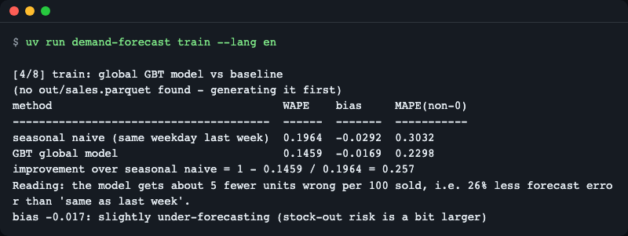
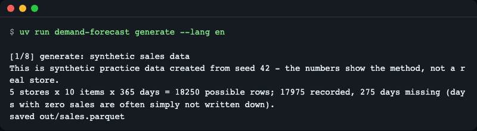
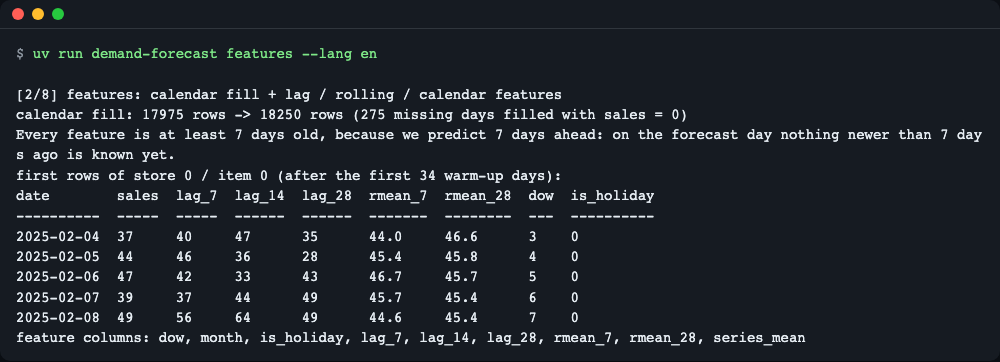
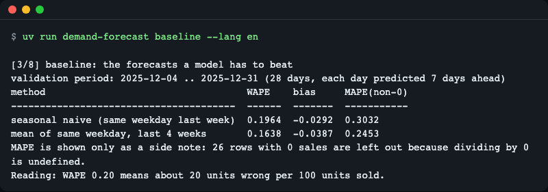
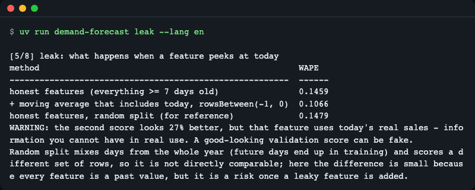
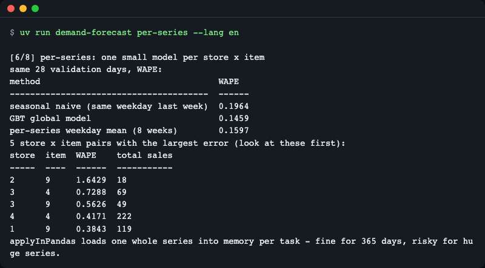
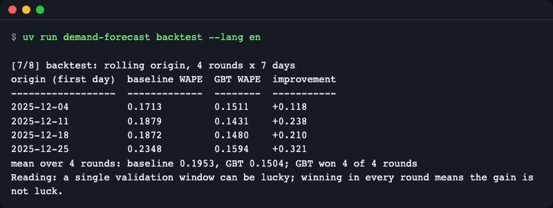
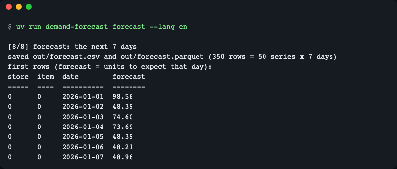
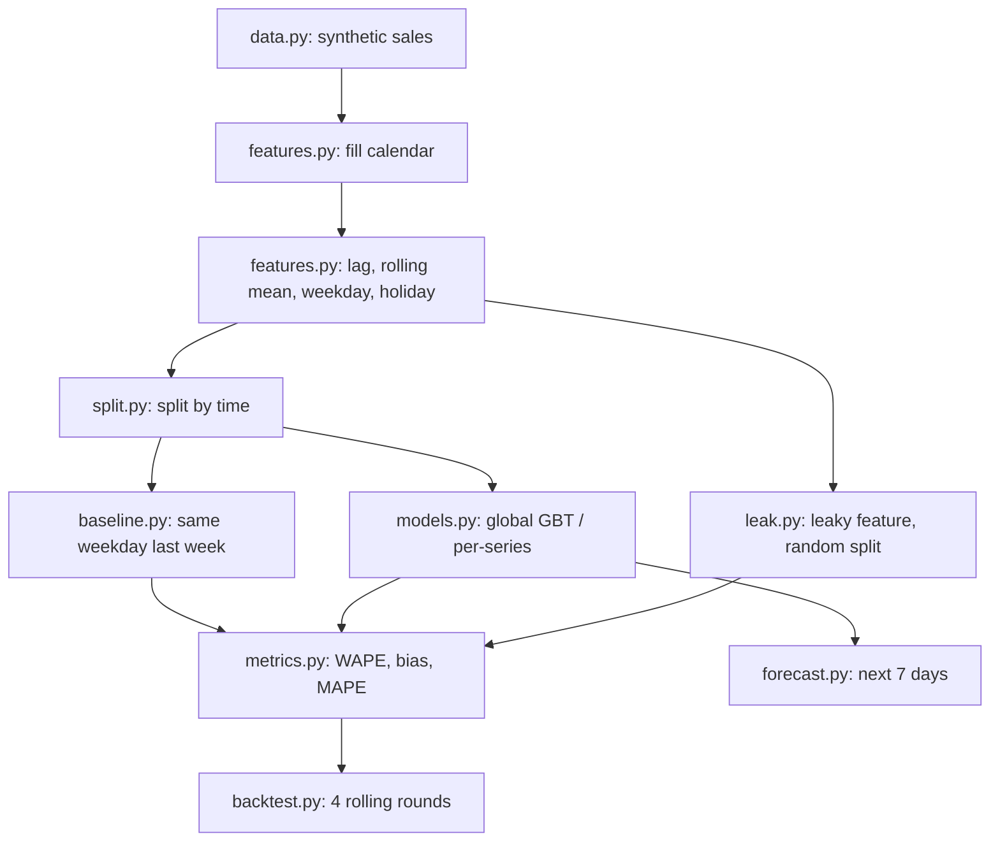

# Demand forecasting with PySpark: lag features, leakage and WAPE, step by step

**English** | [한국어](README.ko.md)

A small command-line demo that forecasts the next 7 days of sales for many store x item pairs with PySpark. It builds lag, moving-average, weekday and holiday features without peeking at the future, then checks whether a model really beats the simple "same as last week" forecast using WAPE. Run it with `uv run demand-forecast all`. It needs Java 17+ but no API key and no internet at run time. This is series part 3 of 5 (PySpark on numeric data).


<sub>The `train` step: the model's WAPE (0.1459) next to the baseline's (0.1964) on 28 held-out days.</sub>

> **Practice data notice.** The sales data is **synthetic**, created from seed 42. The numbers show the method, not a real store. Numbers in this README are examples from one run on one machine; yours should match closely for the same seed but may differ slightly on other platforms or Spark versions.

## In one sentence

After following this demo you can build leak-free time-series features with PySpark window functions, forecast the next 7 days of demand, and decide with WAPE whether your model is really better than the simplest possible forecast.

**Who it is for:** people doing their first sales or demand forecast, people who know PySpark aggregation but not time-series features, and anyone who wants to see what tools like `mlforecast` do before using them.

## Why this matters

Think of a bakery owner who decides tomorrow's dough from last week's sales. "Same as last Tuesday" is a decent rule. A forecasting model is only worth keeping if it makes the owner waste less dough than that rule does. Two traps make a model look better than it is: letting it see information that will not exist at ordering time (leakage), and measuring it once on a lucky stretch of days. This demo shows both traps with real numbers, then does the fair comparison.

## Series

| # | Repo | Topic |
|---|---|---|
| 1 | [ai-lab-pyspark-sales-aggregation](https://github.com/LeeGyeongPil/ai-lab-pyspark-sales-aggregation) | Aggregating sales |
| 2 | [ai-lab-pyspark-price-regression](https://github.com/LeeGyeongPil/ai-lab-pyspark-price-regression) | Price regression |
| 3 | **ai-lab-pyspark-demand-forecast** (this repo) | Demand forecasting |
| 4 | ai-lab-pyspark-churn-scoring | Churn scoring (coming) |
| 5 | ai-lab-pyspark-anomaly-detection | Anomaly detection (coming) |

Each part stands alone.

## Run it in 30 seconds

You need Java 17 or newer, [uv](https://docs.astral.sh/uv/) and git.

```bash
# macOS:  brew install uv openjdk@21
# Linux:  curl -LsSf https://astral.sh/uv/install.sh | sh   and   sudo apt-get install -y openjdk-17-jre-headless git
git clone https://github.com/LeeGyeongPil/ai-lab-pyspark-demand-forecast.git
cd ai-lab-pyspark-demand-forecast
uv run demand-forecast all
```

The first run downloads Python 3.12 and PySpark (a few minutes depending on your network). After that the whole pipeline takes about one minute (53 seconds in my run). Results go to `out/`.

The output language follows your `LANG`. If your system is Korean, the first run prints Korean; add `--lang en` to see English (see [Language](#language)).

There is no mock mode: Spark really computes everything on your machine. The only "practice" part is that the data is generated.

Java is found automatically (`JAVA_HOME`, then Homebrew `openjdk@21`/`@17`, `/usr/lib/jvm/*`, then `PATH`). If Java 17+ is missing, you get a message saying how to install it and exit code 2, not a Java stack trace.

Spark uses a temporary folder inside the project (`.spark-tmp/`). The JVM therefore prints a harmless `Picked up JAVA_TOOL_OPTIONS: ...` line on stderr. Hide it with `2>/dev/null`.

## Follow along, one step at a time

Every step is its own command, so you can read one output at a time. A step that needs earlier files creates them first. All steps accept `--stores`, `--items`, `--days`, `--seed`, `--out`, `--tmp-dir` (or the `DEMAND_FORECAST_TMP` variable) and `--lang en|ko`.

If an existing `out/sales.parquet` was made with different `--stores/--items/--days/--seed`, the step says so, generates the data again and clears the old `report.json` and forecast files. The options used are recorded in `out/sales.params.json`.

### Language

Output is English or Korean. The rule is `--lang en|ko`, then the environment variable `DEMAND_FORECAST_LANG`, then `LC_ALL` / `LC_MESSAGES` / `LANG`. Anything that is not Korean falls back to English.

```bash
uv run demand-forecast all --lang ko
DEMAND_FORECAST_LANG=ko uv run demand-forecast baseline
```

### Step 1. `generate`: make practice data

```bash
uv run demand-forecast generate
```


<sub>5 stores x 10 items x 365 days, with 275 days not recorded.</sub>

What you see: 17,975 recorded rows out of 18,250 possible. The data has higher weekend sales, a bump on fixed holidays, a gentle upward trend, noise, a few slow-selling items with many zero days, and **missing rows** (70% of zero-sale days were never written down, just like many real systems). Nothing is hidden: the generator is [`data.py`](src/demand_forecast/data.py).

### Step 2. `features`: fill the calendar, add lags and averages

```bash
uv run demand-forecast features
```


<sub>First rows of store 0 / item 0: `sales` is the answer, the other columns are what the model may use.</sub>

What you see: `17975 rows -> 18250 rows`. Missing days were added with `sales = 0` first. Without that, `lag(7)` would mean "7 rows back", which is more than 7 days back whenever a day is missing.

Reading the table: `lag_7` is sales 7 days earlier, `rmean_7` is the average of days d-13 to d-7, and `rmean_28` the average of d-34 to d-7. Look at the row for 2025-02-04: `lag_7` is 40, the sales of 2025-01-28.

**Why only values at least 7 days old?** We forecast 7 days ahead. When you place the order, you do not yet know the last 6 days of sales. A feature like "yesterday's sales" would be great in validation and unavailable in real use.

### Step 3. `baseline`: the forecast to beat

```bash
uv run demand-forecast baseline
```


<sub>The validation period is the last 28 days. Each day is predicted 7 days ahead.</sub>

What you see: two baselines. "Seasonal naive" says each day will repeat the same weekday of last week (`lag_7`): WAPE 0.1964. "Mean of the same weekday over 4 weeks" is a bit better: 0.1638.

**WAPE** (weighted absolute percentage error) = sum of |actual - forecast| divided by the sum of actual sales. WAPE 0.20 means about 20 units wrong for every 100 sold. **Bias** is the signed version: negative means under-forecasting, which risks stock-outs. MAPE is shown only as a side note: it divides by each day's actual value, so days with 0 sales break it (26 rows had to be left out).

### Step 4. `train`: one global GBT model for all series

```bash
uv run demand-forecast train
```

(This is the picture at the top of the page.) `GBTRegressor` is Spark MLlib's gradient-boosted trees model. One model learns from all 50 series at once.

What you see: WAPE 0.1459 against 0.1964, an improvement of `1 - 0.1459 / 0.1964 = 0.257`. In plain words: about 5 fewer units wrong per 100 sold, 26% less error than "same as last week". Bias is -0.017, so it slightly under-forecasts.

### Step 5. `leak`: a score that is too good to be true

```bash
uv run demand-forecast leak
```


<sub>The leaky feature "improves" WAPE from 0.1459 to 0.1066 and still means nothing.</sub>

What you see: we add one extra feature, a moving average over `rowsBetween(-1, 0)`, that is yesterday and **today**. Today's sales is the very number we are predicting. The score jumps by 27%, but in real use that value does not exist yet. That is **leakage**: the validation score looks great and the deployed model disappoints.

The last row, a **random split** (rows from the whole year mixed into training), scores 0.1479. It scores different rows, so it is not directly comparable. Here the gap is small because every honest feature is a past value. The rule still stands: for forecasting, split by time.

### Step 6. `per-series`: one small model per store x item

```bash
uv run demand-forecast per-series
```


<sub>Per-series weekday means (0.1597) do not beat the global model (0.1459).</sub>

What you see: `applyInPandas` runs a tiny pandas model, the mean of the same weekday over 8 weeks, separately for each of the 50 pairs. The global model wins here. The table lists the five pairs with the largest WAPE. The worst, store 2 / item 9, has WAPE 1.64 but sold only 18 units in total, so it barely moves the overall WAPE. That is why WAPE is weighted by volume. Look at those pairs first.

### Step 7. `backtest`: is the win just luck?

```bash
uv run demand-forecast backtest
```


<sub>Four 7-day windows, each moving one week forward.</sub>

What you see: **rolling origin** means repeating the forecast from four different start dates. The model wins all four rounds (+0.118, +0.238, +0.210, +0.321). Mean WAPE is 0.1953 for the baseline and 0.1504 for the model. One lucky window can mislead; four wins in a row is much harder to explain by luck.

### Step 8. `forecast`: the next 7 days

```bash
uv run demand-forecast forecast
```


<sub>350 rows = 50 series x 7 days, saved as `out/forecast.csv` and `out/forecast.parquet`.</sub>

What you see: expected units per store, item and day for 2026-01-01 to 2026-01-07. Note 2026-01-01 for store 0 / item 0: 98.56 against about 48 on a normal day, because January 1st is in the holiday list. All metrics of a run are collected in `out/report.json`.

## How this differs from part 2 (regression)

In part 2 each row was independent: shuffle the rows, split at random, done. With time in the data, rows are not independent. Today's sales depend on last week's, so the split must be by date (train on the past, test on the later days), every feature must be computed from values that exist at ordering time, and the yardstick is a simple rule such as "same weekday last week", not just an error number.

## Common pitfalls

- **Missing dates.** A store that sold nothing may have no row. `lag(7)` then means "7 rows back", not 7 days. Fill the calendar first (step 2).
- **A window that includes today.** A moving average over days d-6..d contains the value you want to predict. Use only days up to d-7.
- **Random split.** It mixes future days into training. Here the effect is small because all features are past values, but it grows with leaky features or a trend (step 5).
- **MAPE and zeros.** Percent error divides by actual sales, which blows up on days with 0 or 1. WAPE divides the total error by total sales.
- **Weekday numbers.** Spark `dayofweek` is 1 = Sunday; pandas `dayofweek` is 0 = Monday. This repo uses the Spark numbering everywhere (`dow` 1-7).
- **`applyInPandas` memory.** Each group is loaded into memory as one pandas DataFrame. That is fine for 50 series with 365 days; a huge or skewed group can run out of memory (see the PySpark docs).
- **Sandbox temp folder and `JAVA_HOME`.** If Java cannot write its temp folder you only see `JAVA_GATEWAY_EXITED`; use `--tmp-dir`. If Java 17+ is not found, set `JAVA_HOME`.

## How it works



- Synthetic sales are created from a fixed seed, so results repeat.
- The calendar is filled so that every store x item has one row per day.
- Features look only 7 or more days back, matching the 7-day horizon.
- The split is by time: train on days before the cutoff, validate on the 28 days after.
- The baseline and the models are scored with the same metric on the same rows.
- Backtest repeats the evaluation four times; forecast writes the final table.

## Code tour

| File | What it does |
|---|---|
| [`cli.py`](src/demand_forecast/cli.py) | Sub-commands and common options |
| [`sparkenv.py`](src/demand_forecast/sparkenv.py) | Finds Java, sets the temp folder, starts Spark |
| [`data.py`](src/demand_forecast/data.py) | Synthetic data and the holiday list |
| [`features.py`](src/demand_forecast/features.py) | Calendar fill and window features |
| [`split.py`](src/demand_forecast/split.py) | Time split and backtest start dates |
| [`metrics.py`](src/demand_forecast/metrics.py) | WAPE, bias, MAPE, improvement |
| [`models.py`](src/demand_forecast/models.py) | Global GBT and the `applyInPandas` model |
| [`leak.py`](src/demand_forecast/leak.py) | Leakage experiment |

**1. Windows that stop 7 days back** (`features.py`). A window ending at `-7` can never touch the last 6 days:

```python
w = Window.partitionBy(*SERIES).orderBy("date")
...
.withColumn("lag_7", F.lag("sales", 7).over(w))
.withColumn("rmean_7", F.avg("sales").over(w.rowsBetween(-13, -7)))
.withColumn("rmean_28", F.avg("sales").over(w.rowsBetween(-34, -7)))
```

**2. The leaky window** (`leak.py`). `(-1, 0)` includes row 0, today:

```python
LEAK_WINDOW = (-1, 0)
w = Window.partitionBy(*SERIES).orderBy("date").rowsBetween(*window)
return filled.withColumn(LEAK_COLUMN, F.avg("sales").over(w))
```

**3. WAPE** (`metrics.py`). One aggregation over the whole DataFrame, divided by the total:

```python
F.sum(F.abs(F.col(actual) - F.col(pred)))   # abs_err
F.sum(F.col(actual))                        # total   ->  WAPE = abs_err / total
```

## Glossary

| Term | Meaning |
|---|---|
| Time series | Numbers recorded in time order, here daily sales |
| Lag | The value from some days earlier (`lag_7` = 7 days ago) |
| Moving average | Average over a sliding range of recent days |
| Window function | Spark's way to look at neighbouring rows of the same group |
| Horizon | How far ahead you forecast (7 days here) |
| Leakage | A feature that uses information not available at forecast time |
| Split by time | Train on the past, validate on the days after it |
| Baseline | A very simple forecast the model must beat |
| Seasonal naive | Baseline: same weekday last week |
| WAPE | Total absolute error divided by total actual sales |
| Bias | Signed error share; negative = under-forecast |
| Rolling-origin backtest | Repeating the forecast from several start dates |

## Try changing things

1. **A wider "peek" window.** In a copy of the repo, change `LEAK_WINDOW = (-1, 0)` in `src/demand_forecast/leak.py` to `(-3, 3)`, then run `uv run demand-forecast leak`. Expected: the leaky score improves less (0.1350 vs 0.1459, about 7%) but is still a cheat. Check the line starting with `+ moving average that includes today`.
2. **Another seed.** `uv run demand-forecast train --seed 7 --out out/seed7`. Expected: different data and different numbers (baseline 0.1827, model 0.1302, improvement 0.287) but the model still wins. Check the `improvement` line.
3. **Less data.** `uv run demand-forecast baseline --stores 2 --items 3 --days 120`. Expected: a small, quick run (baseline WAPE 0.1858 for seasonal naive). `--days` must be at least 120. If you ran `all` before, the step prints a notice and regenerates `out/sales.parquet` for the new options; run without options later to get the default data back (0.1964).

## Troubleshooting

| Symptom | Cause | Fix |
|---|---|---|
| `Java 17+ not found` and exit code 2 | No Java, or older than 17 | Install it (`brew install openjdk@21`, or `sudo apt-get install -y openjdk-17-jre-headless`) or set `JAVA_HOME` |
| `JAVA_GATEWAY_EXITED` or a Spark start error | Java cannot write its temp folder | Use `--tmp-dir <writable folder>` or set `DEMAND_FORECAST_TMP` |
| `Picked up JAVA_TOOL_OPTIONS` line in the output | The project sets a temp folder for Java | Harmless; add `2>/dev/null` |
| pandas 3 `FutureWarning` or a build error on Python 3.15 | This demo is pinned to Python 3.12 and pandas < 3 | Use `uv run` so the pinned versions are used |
| Numbers differ a little from this README | Other platform or Spark build | Compare the pattern: the model beats the baseline, the leaky score is too good |

## Run the tests

```bash
uv run pytest -q
```

About 2 minutes (most of it is Spark training). Java 17+ is required.

## Learn more

- [Forecasting: Principles and Practice, simple methods (seasonal naive)](https://otexts.com/fpp3/simple-methods.html)
- [PySpark window functions API](https://spark.apache.org/docs/latest/api/python/reference/pyspark.sql/window.html)
- [`GroupedData.applyInPandas`](https://spark.apache.org/docs/latest/api/python/reference/pyspark.sql/api/pyspark.sql.GroupedData.applyInPandas.html)
- [MAPE and its zero problem](https://en.wikipedia.org/wiki/Mean_absolute_percentage_error)
- Production tools for the same job: [mlforecast](https://github.com/nixtla/mlforecast) and [statsforecast](https://github.com/Nixtla/statsforecast)

Links checked 2026-11-15. Versions used: PySpark 4.3.0, pandas 2.3.3, Python 3.12, OpenJDK 21.

## License

MIT, see [LICENSE](LICENSE). The data is generated by this repo's code, so there is no external data license.
